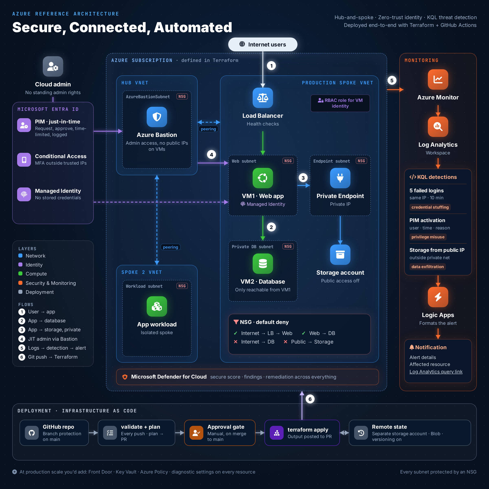

# Azure Secure Landing Zone

**Hub-and-spoke network · zero-trust identity · KQL threat detection · Terraform + GitHub Actions (OIDC)**

> **Status: in progress — not yet deployed.**
> The Terraform passes `terraform fmt`, `terraform validate`, TFLint and Checkov. Nothing has been applied to Azure yet. The [Evidence](#evidence) section gets filled in only after a real deployment.


---

## The business problem

A regional healthcare provider (about 400 staff, a patient-portal web app, and a small internal database) is moving its first workloads to Azure. The security and compliance team raised three problems:

1. **Identity is the perimeter, and it's weak.** Staff sign in from clinics, homes and phones. Several IT people hold permanent Global Admin rights. One phished admin account could expose patient data (PHI).
2. **Nobody would notice an attack.** No one watches sign-in failures, privileged role use, or access to data stores. A password-spray attack or a data pull from an unexpected IP would go unseen.
3. **Changes are made by hand.** Resources are built in the portal, so no two environments match, nothing is reviewed, and auditors can't see who changed what.

**This project builds a landing zone that fixes all three:**

| Problem | Control in this repo |
|---|---|
| Weak identity | Conditional Access (MFA outside trusted locations, block legacy auth), PIM just-in-time admin, managed identities instead of stored credentials |
| No detection | Log Analytics + diagnostic settings, 3 KQL alert rules (password spray, PIM activation, storage access from a public IP), Action Group + Logic App notifications, Defender for Cloud |
| Manual, unaudited change | Everything in Terraform, remote versioned state, GitHub Actions with plan-on-PR, security scanning, a manual approval gate and branch protection — authenticated with OIDC (no stored secrets) |

---

## Architecture



> The diagram shows the reference design. This repo adds a few extras on top of it: Key Vault with a private endpoint, private DNS zones, a NAT gateway for controlled outbound traffic, a block-legacy-auth CA policy, and budget alerts. Private endpoints sit in a **hub** shared-services subnet so every spoke can reach them through peering.

### Network layout

| VNET | CIDR | Subnets | Purpose |
|---|---|---|---|
| `vnet-slz-dev-hub` | 10.0.0.0/16 | `AzureBastionSubnet` 10.0.1.0/26, `snet-privatelink` 10.0.2.0/24 | Shared services: Bastion, private endpoints |
| `vnet-slz-dev-spoke-app` | 10.1.0.0/16 | `snet-web` 10.1.1.0/24, `snet-db` 10.1.2.0/24 | Production workload |
| `vnet-slz-dev-spoke-mgmt` | 10.2.0.0/16 | `snet-mgmt` 10.2.1.0/24 | Isolated ops / tooling spoke |

Hub↔spoke peering goes both ways. Spokes can't reach each other directly (peering is non-transitive), which is on purpose.

---

## Components by layer

### Network — `modules/network`
- Hub VNET plus two spoke VNETs, with two-way hub↔spoke peering
- **An NSG on every subnet**, each ending in an explicit `DenyAllInbound` (priority 4096). Allow rules are least-privilege:
  - Web: HTTP 80 from `allowed_http_source` (narrow this to your IP in the lab), LB health probe, SSH **only from the Bastion subnet**
  - DB: PostgreSQL 5432 **only from the web subnet**, SSH only from Bastion
  - Private endpoints: HTTPS 443 only from the web subnet
  - Bastion: the rule set Microsoft requires
- **Azure Bastion (Basic)** — browser-based SSH, so VMs never get public IPs *(toggle: `enable_bastion`)*
- **NAT gateway** — subnets have `default_outbound_access_enabled = false`, so outbound traffic is explicit *(toggle: `enable_nat_gateway`)*
- Optional route tables that force spoke traffic to a future firewall *(toggle: `enable_route_tables`)*

### Compute — `modules/compute`
- Ubuntu 24.04 web VM(s) (`Standard_B1s`, count 1–3) behind a **Standard Load Balancer** with an HTTP `/health` probe
- Ubuntu DB VM (`Standard_B2s`) running PostgreSQL in the private subnet. It has no public IP and isn't in the LB pool.
- **System-assigned managed identity** on each VM. Web VMs get `Storage Blob Data Reader` on the storage account and `Key Vault Secrets User` on Key Vault. No secrets live on disk.
- SSH-key auth only (password auth disabled), and **daily auto-shutdown** at 19:00 ET

> TFLint notes that the B-series v1 sizes are announced for retirement. They're fine for this lab. For anything long-lived, switch `web_vm_size`/`db_vm_size` to a v2 size such as `Standard_B2ats_v2`.

### Storage — `modules/storage`
- StorageV2 with `public_network_access_enabled = false`, **shared keys disabled** (Entra ID auth only), TLS 1.2+, infrastructure encryption, blob versioning and soft delete
- **Private endpoint** (blob) plus a `privatelink.blob.core.windows.net` private DNS zone linked to all three VNETs

### Key Vault — `modules/keyvault`
- Standard SKU, RBAC authorization, public access disabled, a private endpoint and a `privatelink.vaultcore.azure.net` DNS zone
- Purge protection is behind a variable: off in the lab so the vault can be torn down, **on for prod**

### Monitoring — `modules/monitoring`
- Log Analytics workspace (30-day retention, **1 GB/day ingestion cap** to control cost)
- Diagnostic settings for the subscription Activity Log, blob service, Key Vault, every NSG, the Load Balancer, and **Entra ID sign-in/audit logs**
- 3 scheduled-query alert rules → Action Group (email) → optional **Logic App** that posts to a Teams/Slack webhook
- Monthly **budget** alerts at 50/80/100% actual and 100% forecast

### Identity — `modules/identity` (azuread provider)
- Trusted **named location** (your IP ranges)
- **CA01** requires MFA everywhere except the trusted location. **CA02** blocks legacy authentication.
- Both policies are **report-only by default** (`ca_enforce = false`), target a pilot group, and exclude break-glass accounts
- **PIM**: an *eligible* (not active) assignment of an admin role. The provider can't manage PIM role settings, so those are a documented portal step: [docs/IDENTITY_MANUAL_STEPS.md](docs/IDENTITY_MANUAL_STEPS.md)

### Defender for Cloud — `modules/defender`
- Free foundational CSPM (secure score) is always on. The paid plans (Servers P1, Storage, Key Vault) stay **off** unless `enable_defender_paid_plans = true`.

---

## Design decisions

| Decision | Chosen | Alternative | Why |
|---|---|---|---|
| Network topology | **Hub-and-spoke** | Flat single VNET | Shared services (Bastion, private endpoints, later a firewall) live in one place. Workloads stay isolated with their own blast radius, and adding a spoke is a small change. This is the CAF landing-zone pattern. |
| Admin access | **Azure Bastion** | VPN gateway / public IP + SSH | No public IPs on VMs, no client to manage, and sessions run over TLS from the portal. A VPN gateway costs more, takes ~30 min to deploy, and suits site-to-site connectivity better than admin access. |
| Workload → Azure auth | **Managed identity** | Service principal + client secret | No secret to store, rotate or leak. RBAC is scoped to exactly one storage account and one vault. |
| CI/CD → Azure auth | **OIDC federated credentials** | Client secret in GitHub secrets | GitHub issues a short-lived token per job. Federated subjects (main branch, `pull_request`, `environment:production`) control which workflows can authenticate. Nothing long-lived to steal. |
| Admin rights | **PIM eligible (JIT)** | Permanent role assignment | No standing privilege. Activation is time-boxed, needs MFA and a justification, and is logged — and alerted on by KQL rule #2. |
| PaaS connectivity | **Private endpoint + private DNS** | Service endpoints / public firewall rules | Data never crosses a public endpoint, and public network access is fully disabled. Private DNS makes the normal FQDN resolve to the private IP, so apps need no changes. |
| Conditional Access rollout | **Report-only first** | Enforce immediately | Report-only shows who *would* be blocked without locking anyone out, including the person deploying. Flip `ca_enforce = true` after reviewing sign-in logs. Break-glass accounts are always excluded. |
| Outbound internet | **NAT gateway, default outbound off** | Implicit default outbound | Azure is retiring implicit outbound. Explicit egress gives a known, static source IP. |
| Remote state | **Versioned blob, Entra auth, delete lock** | Local state / shared-key access | Every state write is a recoverable version. No storage keys are used, and a `CanNotDelete` lock plus `prevent_destroy` protects the state account. |
| Security scanning | **Checkov + TFLint, fail on findings** | Advisory only | Findings block the PR. Accepted risks are documented inline with `#checkov:skip=<ID>:<reason>` so the exception is visible in code review. |

---

## Security & monitoring

The KQL in [`kql/`](kql/) is the single source of truth. The alert rules load these files with `file()`, so what's in git is exactly what runs.

| # | Rule | Logic | Table | MITRE | Severity |
|---|---|---|---|---|---|
| 1 | Password spray / brute force | ≥5 failed sign-ins from one IP in 10 min | `SigninLogs` | T1110 | 1 |
| 2 | PIM admin activation | Any completed PIM role activation | `AuditLogs` | T1078.004 | 2 |
| 3 | Storage access from public IP | Any blob request from a non-RFC1918 address | `StorageBlobLogs` | T1530 | 1 |

```kql
// kql/failed_signins_same_ip.kql (excerpt)
SigninLogs
| where ResultType != "0"
| summarize FailedAttempts = count(), TargetUsers = make_set(UserPrincipalName, 20) by IPAddress
| where FailedAttempts >= 5
```

Alert flow: **Log Analytics → scheduled query rule (every 5 min) → Action Group → email + Logic App → Teams/Slack**

---

## CI/CD flow

```
feature branch push ──► static checks: fmt · validate · TFLint · Checkov   (no Azure login)
        │
        ▼
pull request → main ──► static checks ──► OIDC login ──► terraform plan ──► plan posted as PR comment
        │                                                        (branch protection: PR + passing checks required)
        ▼ merge
push to main ──► plan (saved artifact) ──► ⏸ "production" environment approval ──► terraform apply <saved plan>

manual: terraform-destroy (type DESTROY + approval) ──► terraform destroy
```

| Workflow | Trigger | OIDC subject |
|---|---|---|
| `terraform-plan.yml` | PR to `main`; push to any other branch (static checks only) | `repo:<owner>/<repo>:pull_request` |
| `terraform-apply.yml` | push to `main` | `ref:refs/heads/main` (plan), `environment:production` (apply) |
| `terraform-destroy.yml` | `workflow_dispatch` with `confirm = DESTROY` | `environment:production` |

Setup steps: [docs/SETUP.md](docs/SETUP.md)

---

## Cost & teardown guardrails

| Item | Approx. cost (East US, pay-as-you-go) | Guardrail |
|---|---|---|
| Azure Bastion Basic | **~$0.19/hr while it exists** (~$140/mo if left up) | `enable_bastion` toggle; destroy every session |
| NAT gateway | ~$0.045/hr + data | `enable_nat_gateway` toggle |
| Standard LB + public IPs | ~$0.025/hr LB + ~$0.005/hr per IP | destroyed with the stack |
| B1s / B2s VMs | ~$0.01 / ~$0.04 per hr | auto-shutdown 19:00 ET |
| Log Analytics | per GB ingested | 1 GB/day cap |
| Defender paid plans | per resource/month | **off by default** |

*Prices are approximate list prices. Check the Azure pricing calculator for current numbers.*

- **Destroy after every session**: run `terraform destroy` or the `terraform-destroy` workflow. Only `bootstrap/` (state storage, cents per month) stays up.
- **Budget alerts** at 50/80/100% of `budget_amount` (default $50)
- **Azure free account**: $200 credit for 30 days. **Entra ID P2 trial**: 30 days (needed for PIM and the sign-in/audit tables). Write and `plan` everything *before* starting either trial — see [docs/DEPLOY_PLAN.md](docs/DEPLOY_PLAN.md).

---

## Evidence

> Nothing below has been captured yet. Each box gets checked only with a real screenshot from a real deployment, saved in `docs/images/evidence/`.

- [ ] `terraform plan` PR comment posted by GitHub Actions
- [ ] Production environment approval gate waiting for review
- [ ] Successful `terraform apply` run log
- [ ] Branch protection rules on `main`
- [ ] Resource groups and resources in the portal, showing tags
- [ ] VNET peering status: Connected (hub ↔ both spokes)
- [ ] NSG effective security rules on the web and DB NICs
- [ ] Bastion SSH session into the web VM (VM has no public IP)
- [ ] `curl http://<lb-ip>/` served by the web VM, plus LB health probe status
- [ ] DB reachable from web (`nc -zv <db-ip> 5432`) and blocked from elsewhere
- [ ] `nslookup <storage>.blob.core.windows.net` from the VM resolving to a 10.0.2.x private IP
- [ ] Storage access denied from a public IP
- [ ] Managed identity reading a blob with `az login --identity` (no keys)
- [ ] Conditional Access policy in report-only, with sign-in log "Report-only: Failure/Success" detail
- [ ] PIM eligible assignment and an activation (with justification)
- [ ] Each KQL query returning results in Log Analytics
- [ ] Each alert firing, with the email and Teams/Slack notification
- [ ] Defender for Cloud secure score / recommendations
- [ ] Budget alert configuration
- [ ] `terraform destroy` completed (teardown proof)

---

## At production scale

What I'd add before running real patient workloads:

- **Azure Front Door / Application Gateway with WAF** and HTTPS (managed certs) in front of the web tier, with the LB made internal
- **Azure Firewall** (or an NVA) in the hub with forced tunneling. The route-table toggle is already there.
- **Azure Policy** initiatives (e.g. HIPAA/HITRUST, CIS) with deny/deployIfNotExists, assigned at management-group scope
- **Diagnostic settings on every resource**, enforced by Policy; Azure Monitor Agent + DCRs for VM logs; VNET flow logs + Traffic Analytics
- **Microsoft Sentinel** on the workspace, with these KQL rules promoted to analytics rules and playbooks
- **Multiple environments** (dev/test/prod) in separate subscriptions under management groups, each with its own state key and GitHub environment
- **Customer-managed keys** in Key Vault Premium/Managed HSM, Key Vault purge protection on, and ZRS/GRS storage
- **Availability zones / VM Scale Sets** for the web tier; Azure Database for PostgreSQL Flexible Server instead of a DB VM
- **Private state backend** (private endpoint + self-hosted runners), plus Terraform drift detection on a schedule
- **Entra ID**: phishing-resistant MFA (FIDO2), risk-based CA (Identity Protection), access reviews for PIM-eligible roles, workload identity CA

---

## Compliance and risk

This is a portfolio lab, not a certified environment. The controls line up with common healthcare frameworks like this:

| Control area | HIPAA Security Rule | NIST 800-53 | Implemented by |
|---|---|---|---|
| Unique identity & MFA | §164.312(a)(2)(i), (d) | IA-2, IA-2(1) | Conditional Access CA01/CA02 |
| Least privilege / JIT admin | §164.308(a)(4) | AC-2, AC-6, AC-6(5) | PIM eligible assignment, scoped RBAC |
| Audit logging | §164.312(b) | AU-2, AU-6, AU-12 | Diagnostic settings → Log Analytics |
| Threat detection & response | §164.308(a)(1)(ii)(D), (a)(6) | SI-4, IR-4 | KQL alerts, Action Group, Logic App, Defender |
| Transmission security | §164.312(e)(1) | SC-7, SC-8 | Private endpoints, NSG default-deny, TLS 1.2 |
| Integrity / change control | §164.312(c)(1) | CM-2, CM-3 | Terraform, PR review, approval gate, versioned state |

**Accepted risks in the lab (each documented inline as a Checkov skip):** LRS replication, Microsoft-managed keys, Key Vault purge protection off, HTTP (not HTTPS) on the public LB, and a state account reachable from GitHub-hosted runners (mitigated by Entra-only auth with shared keys disabled). Each one has a production fix listed above.

---

## Repository layout

```
.
├── main.tf / variables.tf / outputs.tf / versions.tf
├── terraform.tfvars.example     backend.hcl.example
├── bootstrap/                   # remote-state storage (run once, local state)
├── modules/
│   ├── network/   compute/   storage/   keyvault/
│   ├── monitoring/   identity/   defender/
├── kql/                         # alert queries (single source of truth)
├── docs/  SETUP.md  DEPLOY_PLAN.md  IDENTITY_MANUAL_STEPS.md  images/
└── .github/  workflows/  CODEOWNERS  pull_request_template.md
```

## Quick start (local)

```bash
cd bootstrap && terraform init && terraform apply      # once
cd .. && cp backend.hcl.example backend.hcl            # fill in from bootstrap output
cp terraform.tfvars.example terraform.tfvars           # fill in placeholders
terraform init -backend-config=backend.hcl
terraform plan
terraform apply      # only inside your deploy window
terraform destroy    # end of every session
```

---

*Author: Christian Gallon — SC-300 · AWS SAA-C03 · Security+*
